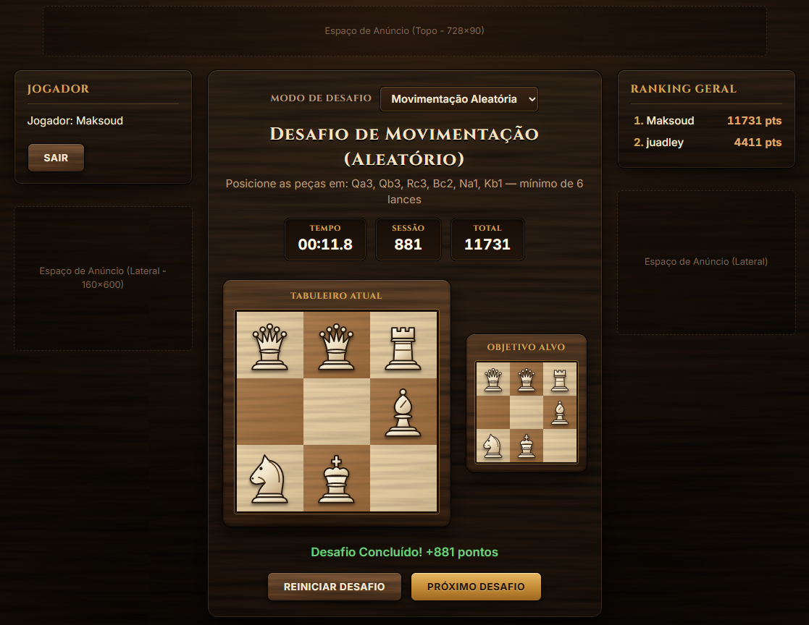

# ChessBrain ♞

Jogo web de desafios de xadrez em um **tabuleiro 3x3**. O jogador resolve dois tipos de desafio contra o relógio, acumula pontos e, se estiver cadastrado, aparece no ranking geral.

> Versão atual: **v0.5.0** (desafios de movimentação, mate em X, cadastro e login de usuários).



## Funcionalidades

- **Desafio de Movimentação (aleatório)** — o jogo sorteia uma posição inicial com peças brancas e escolhe, por busca em largura, uma posição‑alvo que exige de 4 a 6 lances no mínimo. O objetivo é reproduzir a posição‑alvo, exibida em um mini‑tabuleiro e em notação algébrica (ex.: `Ra3, Bc1`), junto com o número mínimo de lances. Não há promoção nesse modo: o peão começa na primeira linha (a1–c1) e o alvo tem sempre as mesmas peças da posição inicial. Como o peão não volta, se ele avançar de um jeito que torne o alvo impossível, o desafio recomeça (conta como erro).
- **Mate em X jogadas** — puzzles pré‑cadastrados em que as brancas devem dar xeque‑mate seguindo a sequência de lances da solução. As respostas das pretas são jogadas automaticamente.
- **Interação por clique ou arrastar‑e‑soltar** (Pointer Events, funciona com mouse e toque), com destaque de lances legais e de capturas.
- **Acessibilidade**: tabuleiro jogável pelo teclado, casas descritas para leitores de tela e lances anunciados em voz alta.
- **Regras de xadrez aplicadas ao 3x3**: movimentos de todas as peças, bloqueio de lances que deixam o próprio rei em xeque e detecção de afogamento.
- **Cronômetro e pontuação** — mate vale de 400 (mate em 1) a 1000 (mate em 7) e cai com o tempo e com os erros; movimentação vale até 300 e cai só com os erros.
- **Cadastro e login** com senha criptografada (bcrypt).
- **Ranking geral (Top 10)** persistido em SQLite.
- Espaços reservados para anúncios (topo, laterais e rodapé).

## Stack

| Camada    | Tecnologia                                   |
|-----------|----------------------------------------------|
| Front‑end | HTML, CSS e JavaScript puro (sem framework)  |
| Back‑end  | Node.js + Express 4                          |
| Banco     | SQLite 3 (arquivo `data/chessbrain.db`)      |
| Senhas    | bcryptjs                                     |

## Estrutura do projeto

```
ChessBrain/
├── server.js            # Servidor Express, API REST e criação do banco SQLite
├── public/              # Única pasta servida ao navegador
│   ├── index.html       # Página única do jogo (layout, modal de login, ranking)
│   ├── styles.css       # Estilos do tabuleiro, layout e modais
│   ├── engine.js        # Regras do xadrez 3x3 (funções puras, sem DOM), usadas no navegador e no Node
│   ├── script.js        # Jogo (classe Chess3x3): UI, validação dos desafios, timer, pontuação, autenticação
│   └── challenges.js    # Gerador de desafios de movimentação + base de puzzles de mate
├── scripts/
│   └── puzzles.js       # Gerador e validador dos puzzles de mate (busca exaustiva)
├── tests/               # Testes automatizados (node:test): motor, puzzles, desafios e API
├── data/
│   └── chessbrain.db    # Banco SQLite (criado na primeira execução, fora do Git)
├── package.json
├── eslint.config.js     # ESLint (Node + scripts do navegador)
├── .prettierrc.json     # Prettier (JS e CSS)
└── docs/
    ├── MELHORIAS.md # Melhorias e problemas identificados
    └── images/      # Capturas de tela usadas na documentação
```

## Como executar

Pré‑requisito: **Node.js** (testado com v24) e npm.

```bash
npm install
npm start
```

O servidor sobe em `http://localhost:3000` (ou na porta definida pela variável de ambiente `PORT`) e escuta em `0.0.0.0` (ou no endereço da variável `HOST`), ou seja, também fica acessível por outros dispositivos da rede local em `http://<SEU_IP_LOCAL>:3000`.

```bash
# Exemplo com outra porta (PowerShell)
$env:PORT=3006; npm start
```

Durante o desenvolvimento, `npm run dev` reinicia o servidor a cada alteração no código. A variável `DB_PATH` aponta o servidor para outro arquivo de banco (os testes usam um temporário).

O arquivo `data/chessbrain.db` e as tabelas são criados automaticamente se não existirem, então um clone novo começa com o banco vazio. O banco não é versionado: cada instalação mantém os próprios usuários e placares. Se houver um `chessbrain.db` na raiz (versões anteriores), ele é movido para `data/` na primeira execução. Apenas a pasta `public/` é servida pelo Express, então o banco e o código do servidor não ficam acessíveis pela rede.

## Atualizar o servidor

No servidor, dentro da pasta do projeto:

```bash
git pull
systemctl restart chessbrain   # reinicia o serviço do ChessBrain
```

O `git pull` não mexe em `data/chessbrain.db`, porque o banco não é versionado.

**Só na primeira atualização depois que o banco saiu do Git** (versão 0.5.1), o `git pull` apagaria o banco do servidor. Nessa vez, guarde o banco antes e devolva depois:

```bash
mv data/chessbrain.db /root/chessbrain.db.bak   # guarda o banco do servidor (/root sobrevive a reboot, ao contrário de /tmp)
git pull                                        # remove a pasta data/, que ficou vazia
mkdir -p data
mv /root/chessbrain.db.bak data/chessbrain.db   # devolve o banco do servidor
chown -R chessbrain:chessbrain data             # o serviço precisa escrever no banco e na pasta
systemctl restart chessbrain
```

## Testes e qualidade

```bash
npm test               # testes do motor, dos puzzles, dos desafios e da API (node:test)
npm run lint           # ESLint
npm run format:check   # confere a formatação (Prettier); npm run format corrige
npm run check:puzzles  # valida a base de puzzles de mate com relatório detalhado
```

Os testes da API sobem o servidor numa porta aleatória com um banco temporário, então não alteram `data/chessbrain.db`.

## Como jogar

1. Escolha o modo no seletor **Modo de Desafio**.
2. Mova as peças brancas clicando na peça e depois na casa de destino, ou arrastando a peça. Pelo teclado, use Tab para entrar no tabuleiro, as setas para mudar de casa e Enter ou Espaço para selecionar e mover (Esc cancela).
3. **Movimentação:** deixe o tabuleiro igual ao **Objetivo Alvo**.
   **Mate em X:** encontre a sequência de lances que dá xeque‑mate. Um lance errado reinicia o desafio.
4. Use **Reiniciar Desafio** para voltar à posição inicial ou **Próximo Desafio** para sortear outro.
5. Faça login para que sua pontuação entre no ranking.

### Coordenadas

O tabuleiro usa notação algébrica reduzida, de `a1` a `c3`. Internamente ele é uma matriz `board[linha][coluna]`, com a linha 0 no topo:

```
        a     b     c
  3   [0,0] [0,1] [0,2]
  2   [1,0] [1,1] [1,2]
  1   [2,0] [2,1] [2,2]
```

Peças são representadas por letras: maiúsculas = brancas (`K Q R B N P`), minúsculas = pretas (`k q r b n p`). O peão que chega à última linha vira Dama automaticamente.

### Pontuação

| Desafio      | Fórmula                                                              |
| ------------ | -------------------------------------------------------------------- |
| Mate em X    | `max(100, floor(400 + (X - 1) * 100 - segundos * 10 - erros * 150))` |
| Movimentação | `max(50, 300 - erros * 50)`                                          |

Conta como **erro** cada recomeço do mesmo desafio depois de pelo menos um lance: jogada incorreta no mate, afogamento ou o botão **Reiniciar**. O cronômetro não zera nesses recomeços, só ao passar para outro desafio. Um desafio já concluído não pontua de novo se for reiniciado. As regras ficam em `ChallengeGenerator.SCORING` ([public/challenges.js](public/challenges.js)).

A pontuação é **acumulada**: os pontos de cada desafio concluído são somados ao total da conta, que é o valor usado no ranking. O painel mostra os pontos ganhos **Nesta visita** (desafios concluídos desde que a página foi aberta; zera ao recarregar ou sair) e o **Total** salvo, carregado ao fazer login. Valores a partir de 100.000 aparecem abreviados ("123 mil", "1,2 mi"), com o número completo no tooltip. Pontos feitos como visitante não são salvos.

## API REST

Todas as rotas recebem e devolvem JSON. Login e cadastro criam uma sessão guardada no cookie `chessbrain_session` (`HttpOnly`, válido por 30 dias), e é por ela que o servidor sabe de quem é a pontuação.

| Método | Rota               | Corpo                                  | Descrição                                                         |
|--------|--------------------|----------------------------------------|-------------------------------------------------------------------|
| POST   | `/api/register`    | `{ "username", "password" }`           | Cadastra o usuário e abre a sessão. Retorna `{ success, user: { id, username, score } }`. |
| POST   | `/api/login`       | `{ "username", "password" }`           | Autentica e abre a sessão. Retorna `{ success, user: { id, username, score } }`. |
| GET    | `/api/me`          | —                                      | Retorna o usuário da sessão: `{ user }` (ou `{ user: null }`).    |
| POST   | `/api/logout`      | —                                      | Encerra a sessão.                                                 |
| POST   | `/api/score`       | `{ "points", "puzzleId"? }`            | **Exige sessão.** Soma os pontos de um desafio (inteiro de 1 a 1.000) ao total do usuário logado. Com `puzzleId` (desafios de mate), guarda também a melhor pontuação naquele jogo. Retorna `{ success, score, best? }`. |
| GET    | `/api/puzzle-best` | —                                      | **Exige sessão.** Melhor pontuação do usuário em cada jogo de mate: `{ "214": 323, ... }`. |
| GET    | `/api/leaderboard` | —                                      | Retorna os 10 melhores: `[{ username, score }]`.                  |

Erros retornam `{ "error": "mensagem" }` com status `400`, `401` ou `500`.

### Banco de dados

Tabela `users`:

| Coluna       | Tipo     | Observação                     |
|--------------|----------|--------------------------------|
| `id`         | INTEGER  | PK, autoincremento             |
| `username`   | TEXT     | Único; no cadastro: 3–20 caracteres `[A-Za-z0-9_.-]` |
| `password`   | TEXT     | Hash bcrypt (custo 10)         |
| `score`      | INTEGER  | Padrão 0 (pontos acumulados)   |
| `created_at` | DATETIME | Padrão `CURRENT_TIMESTAMP`     |

Tabela `sessions`: `token` (TEXT, PK, aleatório), `user_id` (FK para `users`) e `expires_at` (timestamp em ms).

## Adicionando puzzles de mate

Os puzzles ficam em `MATE_PUZZLES_DATABASE`, no arquivo [public/challenges.js](public/challenges.js), agrupados pela quantidade de lances:

```js
2: [
  {
    id: 201,
    title: "Mate em 2 Jogadas",
    type: "mate",
    description: "As Brancas jogam e dão Xeque-Mate em 2 lances!",
    initialBoard: [
      ['B', 'K', null],
      ['n', null, null],
      ['k', 'B', null]
    ],
    // Lances das brancas, em ordem
    solution: [
      { from: { r: 0, c: 1 }, to: { r: 1, c: 2 } },
      { from: { r: 0, c: 0 }, to: { r: 1, c: 1 } }
    ],
    // Resposta das pretas após cada lance das brancas (exceto o último)
    blackResponses: [
      { from: { r: 1, c: 0 }, to: { r: 0, c: 2 } }
    ]
  }
]
```

Regras importantes:
- `solution` deve ter exatamente X lances e `blackResponses`, X − 1.
- O jogo aceita qualquer lance que mantenha o mate forçado nos lances restantes e calcula a resposta das pretas (melhor defesa, de preferência a cadastrada). Mesmo assim, para o puzzle ter uma resposta clara, cada lance da solução deve ser o **único** que mantém o mate no número de lances restantes.
- Cada resposta das pretas deve ser legal e a melhor defesa (a que adia o mate ao máximo).
- Nenhum lance das brancas pode deixar as pretas afogadas antes do mate, porque o jogo detecta o afogamento e reinicia o desafio.
- Peões só podem começar na linha do meio. Ao chegar à última linha, o peão é promovido a Dama automaticamente.

Para conferir tudo isso, rode o validador, que refaz a busca exaustiva de cada puzzle:

```bash
npm run check:puzzles
```

A base atual foi gerada automaticamente pelo mesmo script, que testa todas as posições com rei e até duas peças brancas contra rei e no máximo uma peça preta, e sorteia puzzles de materiais variados (até 5 por nível). Com esse material o mate mais longo possível no 3x3 é em 7 lances.

```bash
# Gera até 5 puzzles por nível, de mate em 1 até mate em 7, e imprime em JSON
npm run generate:puzzles -- 7 5
```
